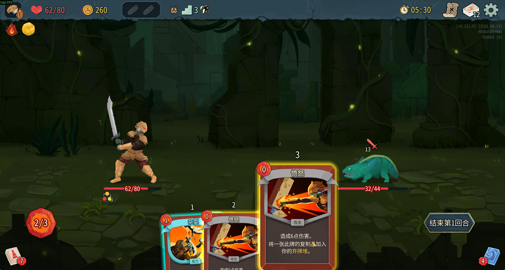

# 杂耍计数器+高亮

**Juggling Counter + Highlight** · Slay the Spire 2


显示「杂耍」的触发倒计数，即将复制下一张攻击牌时高亮手牌中的攻击牌。仅修改显示，不改变游戏机制。

Shows a Juggling countdown and highlights Attack cards in your hand when the next attack will be copied. Visual only; no gameplay changes.

**[Steam 创意工坊 / Subscribe on Steam Workshop](https://steamcommunity.com/sharedfiles/filedetails/?id=3819624503)**



## 构建 / Build

需要 .NET 9 SDK 和已安装的 Windows 版游戏。适配版本：`v0.111.0`。

Requires the .NET 9 SDK and a local Windows game installation. Tested on `v0.111.0`.

```powershell
.\build.ps1 -GameDir 'D:\SteamLibrary\steamapps\common\Slay the Spire 2'
```

将路径替换为你的游戏目录。输出位于 `dist/`。测试说明见 [tests/README.md](tests/README.md)。

Replace the path with your game directory. Output: `dist/`. See [tests/README.md](tests/README.md) for tests.
